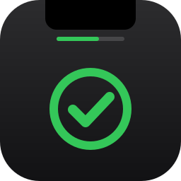

<p align="center">
  
</p>

<h1 align="center">to-notch</h1>

<p align="center">A to-do list that lives in your MacBook's notch.</p>

## What it does

- **Hover over the notch** to see the next pending task; **click** to open the full list. Move the mouse away and it collapses.
- **Add** tasks in the "Nova tarefa…" field (Enter), **check them off** with the circle, and **remove** them with the ×.
- **Click a title** to edit it and add a description.
- **Drag by the handle** (☰) to reorder, with an animated preview of where the task will land.
- A **progress bar** right below the notch shows how much is done.
- **Settings** (gear icon): progress bar color (including an animated RGB option), launch at login, clear completed tasks, delete all tasks, and quit.
- No Dock icon and, when installed as an app, **launches at login**.
- On screens without a notch (external monitors), it uses a strip in the center of the menu bar.

Tasks are saved to `~/Library/Application Support/to-notch/todos.json`.

> The interface is currently in Portuguese (pt-BR).

## Requirements

- macOS 14 (Sonoma) or later
- Swift 6 — Xcode or the Command Line Tools (`xcode-select --install`)

## Installation

```sh
git clone https://github.com/carlosh-dev/to-notch.git
cd to-notch
./install.sh
```

`install.sh` builds in release mode, packages `to-notch.app` (ad-hoc signed, for local use), installs it to `/Applications`, and opens it. Run it again to update.

On first launch the app registers itself as a login item. To turn that off: **System Settings › General › Login Items**, or use the toggle in the app's settings.

### Via .dmg

```sh
./install.sh dmg   # creates .build/to-notch.dmg
```

Open the `.dmg` and drag `to-notch` into **Applications**.

On the Mac where it was built, it opens right away. On another Mac, the ad-hoc signature makes Gatekeeper block it: allow it in **System Settings › Privacy & Security › Open Anyway**, or run `xattr -dr com.apple.quarantine /Applications/to-notch.app`.

To distribute without that warning you need a Developer ID certificate (Apple Developer Program) and notarization:

```sh
xcrun notarytool store-credentials to-notch   # once: Apple ID, Team ID and app-specific password
SIGN_ID="Developer ID Application: Your Name (TEAMID)" NOTARY_PROFILE=to-notch ./install.sh dmg
```

## Development

```sh
swift run    # runs directly, without packaging (doesn't register a login item)
swift test   # tests
```

## Uninstall

```sh
pkill -x to-notch
rm -rf /Applications/to-notch.app
rm -rf ~/Library/Application\ Support/to-notch   # optional: deletes your tasks
```

If it's still listed under Login Items, remove it there.
